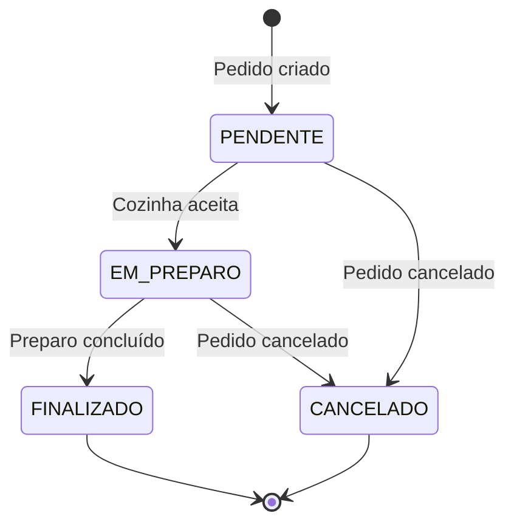

# CoffeeWorld ☕

Sistema completo de pedidos para cafeteria — aplicação full-stack com Angular, Spring Boot e PostgreSQL, totalmente containerizada com Docker.

[](https://angular.dev)
[](https://spring.io/projects/spring-boot)
[](https://openjdk.org/projects/jdk/17/)
[](https://www.postgresql.org/)
[](https://docs.docker.com/compose/)
[](LICENSE)

---

## Sobre o projeto

O CoffeeWorld é um sistema de gestão de pedidos para cafeterias que cobre todo o fluxo: cliente monta o pedido pelo cardápio digital, pedido entra na fila da cozinha com status em tempo real, e a equipe atualiza o andamento até a entrega.

---

## Funcionalidades

- **Cardápio** — listagem de produtos com nome, descrição, preço, categoria e tempo de preparo
- **Carrinho** — montagem e revisão do pedido antes de confirmar
- **Pedidos** — criação, consulta por ID e filtragem por status
- **Painel da Cozinha** — visão dos pedidos em aberto e atualização de status
- **Avaliações** — registro e consulta de feedback por pedido
- **Autenticação e Perfis** — cadastro e login com JWT e controle de acesso por perfis (Cliente, Cozinha e Administrador)

---

## Arquitetura

```mermaid
flowchart TD
    User([Cliente / Cozinha / Admin]) -->|HTTP :80| FE[Angular 19\nSpaCoffeeWorld]

    FE -->|REST :8080| BE[Spring Boot 3\nBackend API]

    subgraph API Endpoints
        BE --> P0[POST /api/auth/register, login]
        BE --> P1[GET/POST/PUT/DELETE /api/produtos]
        BE --> P2[GET/POST/PATCH/DELETE /api/pedidos]
        BE --> P3[GET/POST /api/avaliacoes/pedido/{id}]
    end

    BE -->|JPA / Hibernate| DB[(PostgreSQL 15\ncoffe-world)]

    subgraph Docker Compose
        FE
        BE
        DB
    end
```

---

## Fluxo do Pedido



---

## Stack Tecnológica

### Frontend
| Tecnologia | Versão | Uso |
|---|---|---|
| Angular | 19.2.7 | Framework SPA |
| TypeScript | ~5.7.2 | Linguagem principal |
| Bootstrap | 5.3.2 | Estilização e componentes UI |
| Angular Router | — | Navegação entre views |

### Backend
| Tecnologia | Versão | Uso |
|---|---|---|
| Java | 17 | Linguagem principal |
| Spring Boot | 3.4.5 | Framework web |
| Spring Security | — | Autenticação e autorização RBAC |
| JJWT (io.jsonwebtoken) | 0.12.6 | Geração e validação de tokens JWT |
| Spring Validation | — | Validação declarativa de requisições (@Valid) |
| Spring Data JPA | — | Persistência ORM |
| PostgreSQL | 15 | Banco de dados relacional |
| MapStruct | 1.5.5 | Mapeamento DTO ↔ Entity |
| Lombok | 1.18.34 | Redução de boilerplate |
| Springdoc OpenAPI | 2.7.0 | Documentação Swagger |

### Infraestrutura
| Tecnologia | Uso |
|---|---|
| Docker | Containerização |
| Docker Compose | Orquestração dos 3 serviços |
| Nginx (Alpine) | Web server e proxy reverso no container frontend |

---

## Como Executar

### Pré-requisito
- Docker e Docker Compose instalados (modo containerizado)
- Node.js 18+ e Java 17+ / Maven 3.9+ (caso execute os serviços nativamente sem Docker)

### 1. Clone o repositório
```bash
git clone https://github.com/odavid062/CoffeeWorldPJ.git
cd CoffeeWorldPJ/CoffeeWorldPJ
```

### 2. Configure as variáveis de ambiente
Crie o arquivo `.env` a partir do modelo `.env.example`:
```bash
cp .env.example .env
```

### 3. Suba os serviços
```bash
docker compose up --build
```

| Serviço | URL |
|---|---|
| Frontend (Angular) | http://localhost |
| Backend (API) | http://localhost:8080 |
| Swagger UI | http://localhost:8080/swagger-ui.html |
| PostgreSQL | localhost:5432 |

> Para parar: `docker compose down`  
> Para apagar os dados do banco também: `docker compose down -v`

> **Nota sobre contas de teste (Dev):** Em ambiente local de desenvolvimento, o sistema cria automaticamente contas de teste via `DataInitializer` (administrador com perfil `ADMIN` e equipe da cozinha com perfil `COZINHEIRO`), parametrizadas via variáveis de ambiente.

---

## Variáveis de Ambiente

| Variável | Onde é configurada | Finalidade |
|---|---|---|
| `DB_USER` | `docker-compose.yml`, `.env` | Usuário do banco PostgreSQL |
| `DB_PASSWORD` | `docker-compose.yml`, `.env` | Senha do banco PostgreSQL |
| `DB_NAME` | `docker-compose.yml`, `.env` | Nome do banco PostgreSQL |
| `BACKEND_URL` | `frontend` (`Dockerfile`, `nginx.conf.template`) | Endereço do backend para proxy reverso Nginx |
| `SPRING_DATASOURCE_URL` | `backend` (`application.properties`) | URL de conexão JDBC com o banco |
| `SPRING_DATASOURCE_USERNAME` | `backend` (`application.properties`) | Usuário da conexão com o banco |
| `SPRING_DATASOURCE_PASSWORD` | `backend` (`application.properties`) | Senha da conexão com o banco |
| `ALLOWED_ORIGINS` | `backend` (`application.properties`) | Origens CORS autorizadas |
| `JWT_SECRET` | `backend` (`application.properties`) | Chave para assinatura e verificação do token JWT |
| `JWT_EXPIRATION` | `backend` (`application.properties`) | Tempo de expiração do token JWT em milissegundos |
| `ADMIN_EMAIL` | `backend` (`application.properties`) | E-mail para seed inicial da conta administradora |
| `ADMIN_PASSWORD` | `backend` (`application.properties`) | Senha para seed inicial da conta administradora |
| `ADMIN_NAME` | `backend` (`application.properties`) | Nome do administrador inicial |
| `COZINHA_EMAIL` | `backend` (`application.properties`) | E-mail para seed inicial da conta de cozinha |
| `COZINHA_PASSWORD` | `backend` (`application.properties`) | Senha para seed inicial da conta de cozinha |
| `SPRING_PROFILES_ACTIVE` | `backend` (`Dockerfile`) | Perfil de execução do Spring Boot (`dev` ou `prod`) |

---

## Scripts Disponíveis

### Frontend (Angular)
Executados a partir do diretório `CoffeeWorldPJ/CoffeeWorldPJ/frontend`:
- `npm start` ou `ng serve` — Inicia o servidor de desenvolvimento na porta `4200`
- `npm run build` ou `ng build` — Compila a aplicação gerando os artefatos em `dist/`
- `npm run watch` — Compila em modo de observação contínua para desenvolvimento
- `npm test` ou `ng test` — Executa testes unitários via Karma e Jasmine

### Backend (Spring Boot)
Executados a partir do diretório `CoffeeWorldPJ/CoffeeWorldPJ/backend`:
- `mvn spring-boot:run` — Inicia a aplicação Spring Boot em modo de desenvolvimento local
- `mvn clean package` — Compila e empacota o projeto em arquivo JAR executável
- `mvn test` — Executa a suíte de testes automatizados com JUnit e Spring Test

---

## Endpoints da API

### Autenticação
| Método | Rota | Descrição | Acesso |
|---|---|---|---|
| `POST` | `/api/auth/register` | Cadastra novo cliente | Público |
| `POST` | `/api/auth/login` | Autentica usuário e retorna JWT | Público |

### Produtos
| Método | Rota | Descrição | Acesso |
|---|---|---|---|
| `GET` | `/api/produtos` | Lista todos os produtos | Público |
| `GET` | `/api/produtos/{id}` | Busca produto por ID | Público |
| `POST` | `/api/produtos` | Cadastra novo produto | `ADMIN` |
| `PUT` | `/api/produtos/{id}` | Atualiza produto existente | `ADMIN` |
| `DELETE` | `/api/produtos/{id}` | Remove produto | `ADMIN` |

### Pedidos
| Método | Rota | Descrição | Acesso |
|---|---|---|---|
| `GET` | `/api/pedidos` | Lista todos os pedidos | `COZINHEIRO`, `ADMIN` |
| `GET` | `/api/pedidos/{id}` | Busca pedido por ID | `COZINHEIRO`, `ADMIN` |
| `GET` | `/api/pedidos/status/{status}` | Filtra pedidos por status | `COZINHEIRO`, `ADMIN` |
| `POST` | `/api/pedidos` | Cria novo pedido | `CLIENTE`, `ADMIN` |
| `PATCH` | `/api/pedidos/{id}/status` | Atualiza status do pedido | `COZINHEIRO`, `ADMIN` |
| `DELETE` | `/api/pedidos/{id}` | Remove pedido | `ADMIN` |

### Avaliações
| Método | Rota | Descrição | Acesso |
|---|---|---|---|
| `POST` | `/api/avaliacoes/pedido/{pedidoId}` | Registra avaliação para o pedido | `CLIENTE`, `COZINHEIRO`, `ADMIN` |
| `GET` | `/api/avaliacoes/pedido/{pedidoId}` | Busca avaliação vinculada ao pedido | `CLIENTE`, `COZINHEIRO`, `ADMIN` |

### Status disponíveis (StatusPedido)
`PENDENTE` → `EM_PREPARO` → `FINALIZADO` / `CANCELADO`

### Perfis de Acesso (Roles)
- `CLIENTE` — Consulta de cardápio, criação de pedidos e envio de avaliações
- `COZINHEIRO` — Consulta de pedidos em tempo real e atualização de status na cozinha
- `ADMIN` — Gestão completa (produtos, pedidos, cancelamentos e exclusões)

---

## Exemplos de Requisição

### Autenticação (Login)
```bash
curl -X POST http://localhost:8080/api/auth/login \
  -H "Content-Type: application/json" \
  -d '{
    "email": "cliente@exemplo.com",
    "senha": "senhaSegura123"
  }'
```

### Criar produto
```bash
curl -X POST http://localhost:8080/api/produtos \
  -H "Content-Type: application/json" \
  -H "Authorization: Bearer <TOKEN_ADMIN>" \
  -d '{
    "nome": "Cappuccino",
    "descricao": "Espresso com leite vaporizado e espuma",
    "preco": 12.90,
    "categoria": "bebida-quente",
    "tempoPreparoMinutos": 5,
    "imagemUrl": "https://exemplo.com/cappuccino.jpg"
  }'
```

### Criar pedido
```bash
curl -X POST http://localhost:8080/api/pedidos \
  -H "Content-Type: application/json" \
  -H "Authorization: Bearer <TOKEN_CLIENTE>" \
  -d '{
    "cpfCliente": "12345678901",
    "formaPagamento": "PIX",
    "observacao": "Sem açúcar",
    "itens": [
      { "produtoId": 1, "quantidade": 2 }
    ]
  }'
```

### Atualizar status (cozinha aceita pedido)
```bash
curl -X PATCH "http://localhost:8080/api/pedidos/1/status?status=EM_PREPARO" \
  -H "Authorization: Bearer <TOKEN_COZINHEIRO_OU_ADMIN>"
```

### Avaliar pedido
```bash
curl -X POST http://localhost:8080/api/avaliacoes/pedido/1 \
  -H "Content-Type: application/json" \
  -H "Authorization: Bearer <TOKEN_CLIENTE>" \
  -d '{
    "nota": 5,
    "comentario": "Café excelente e entrega rápida!"
  }'
```

---

## Estrutura do Projeto

```
CoffeeWorldPJ/
└── CoffeeWorldPJ/
    ├── backend/                                  # Spring Boot API
    │   ├── Dockerfile                            # Build Maven e container de execução
    │   ├── pom.xml                               # Dependências e plugins Maven
    │   └── src/
    │       ├── main/
    │       │   ├── java/com/coffeworld/backend/
    │       │   │   ├── config/                   # Segurança (JWT, CORS) e DataInitializer
    │       │   │   ├── dto/                      # Data Transfer Objects
    │       │   │   │   └── auth/                 # DTOs de login e registro
    │       │   │   ├── enums/                    # StatusPedido e Role
    │       │   │   ├── filter/                   # JwtAuthFilter (filtro de requisições)
    │       │   │   ├── mapper/                   # MapStruct: Entity ↔ DTO
    │       │   │   ├── model/                    # Entidades JPA (Usuario, Produto, Pedido, Avaliacao)
    │       │   │   ├── repository/               # Interfaces Spring Data JPA
    │       │   │   ├── resource/                 # Controllers REST (Auth, Produto, Pedido, Avaliacao)
    │       │   │   └── service/                  # Regras de negócio e autenticação
    │       │   └── resources/
    │       │       ├── application.properties    # Configurações de desenvolvimento
    │       │       ├── application-prod.properties # Configurações para produção (Railway/Supabase)
    │       │       └── data.sql                  # Carga inicial do cardápio
    │       └── test/                             # Testes automatizados do backend
    ├── frontend/                                 # Angular 19 SPA
    │   ├── Dockerfile                            # Build Node e imagem de produção Nginx
    │   ├── nginx.conf.template                   # Configuração Nginx com proxy reverso dinâmico
    │   ├── package.json                          # Dependências e scripts npm
    │   └── src/
    │       ├── app/
    │       │   ├── components/
    │       │   │   ├── cardapio/                 # Listagem do menu e seleção
    │       │   │   ├── carrinho/                 # Carrinho de compras e checkout
    │       │   │   ├── cozinha/                  # Painel de gestão de pedidos em tempo real
    │       │   │   ├── login/                    # Tela de autenticação e registro
    │       │   │   ├── pedido/                   # Criação e detalhes do pedido
    │       │   │   └── produto/                  # Detalhes do item
    │       │   ├── guards/                       # Guards de rota (authGuard, cozinhaGuard, adminGuard)
    │       │   ├── interceptors/                 # authInterceptor (anexação do Bearer token)
    │       │   ├── models/                       # Interfaces TypeScript
    │       │   └── services/                     # Serviços HTTP da API
    │       └── environments/                     # Variáveis de ambiente da SPA
    ├── .env.example                              # Modelo de variáveis de ambiente
    └── docker-compose.yml                        # Orquestração local (db, backend, frontend)
```

---

## Testes

### Testes no Frontend
Executados com o Karma runner e Jasmine a partir de `CoffeeWorldPJ/CoffeeWorldPJ/frontend`:
```bash
npm test
```

### Testes no Backend
Executados com JUnit e o runner do Spring Boot Starter Test a partir de `CoffeeWorldPJ/CoffeeWorldPJ/backend`:
```bash
mvn test
```

---

## Deploy

O projeto conta com suporte arquitetado para deploy em contêineres e nuvem:
- **Backend (Spring Boot):** Suporta execução com o perfil `prod` via variável `SPRING_PROFILES_ACTIVE=prod`. Em produção (`application-prod.properties`), integra com PostgreSQL gerenciado (ex.: Supabase com SSL obrigatório `?sslmode=require`), validação estrita de schema JPA (`ddl-auto=validate`), desativação de endpoints Swagger e inicialização segura através de variáveis de ambiente exigidas sem fallback. Compatível com plataformas PaaS como o Railway.
- **Frontend (Angular + Nginx):** O build estático da SPA é servido por imagem `nginx:alpine`. O arquivo `nginx.conf.template` injeta a variável `BACKEND_URL` em tempo de execução via `envsubst`, fazendo proxy reverso transparente de todas as requisições `/api/` para o serviço de backend e servindo `index.html` em qualquer rota (SPA fallback).

---

## Documentação Interativa

Após subir a aplicação, acesse o Swagger para testar todos os endpoints diretamente no navegador:

```
http://localhost:8080/swagger-ui.html
```

---

## Autor

**David Rodrigues**  
[](https://github.com/odavid062)

---

## Licença

[MIT](LICENSE)
